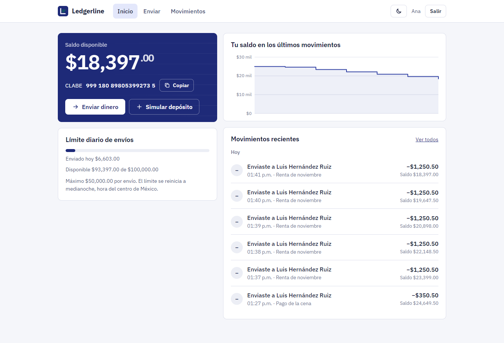
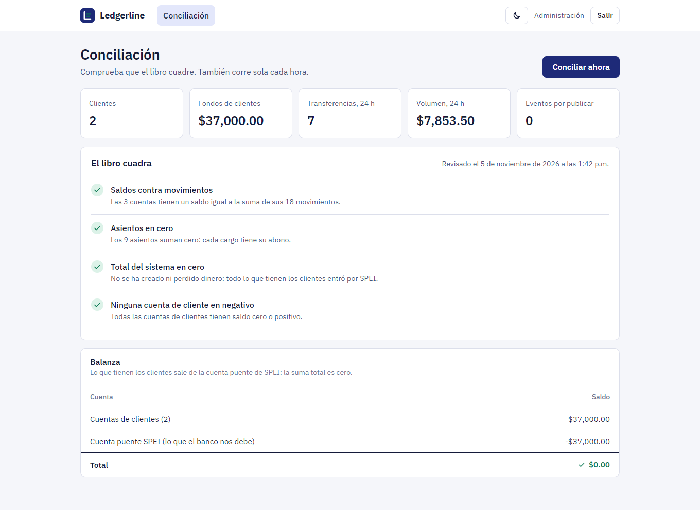
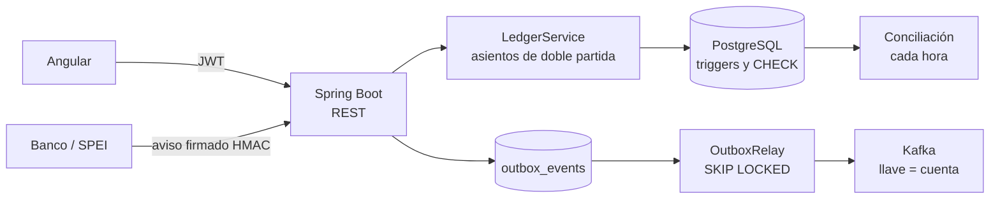
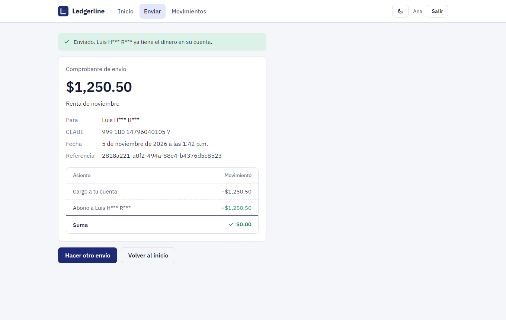

# Ledgerline

**Billetera digital con libro contable de doble partida.** Cada cliente recibe una CLABE, puede recibir depósitos SPEI y enviar dinero a otras cuentas. Cada operación se registra como un asiento cuyos movimientos suman cero, así que el saldo de cualquier cuenta se puede comprobar en todo momento.

[](https://github.com/alexomay/ledgerline/actions/workflows/ci.yml)




## Qué resuelve

Mover dinero parece sencillo hasta que dos operaciones llegan al mismo tiempo, el cliente da doble clic, el banco reenvía una notificación o se corta la conexión a la mitad. Ledgerline está construido alrededor de esos casos:

| Riesgo | Cómo se evita |
|---|---|
| Dos cargos simultáneos dejan una cuenta en negativo | Bloqueo pesimista de las cuentas (`SELECT … FOR UPDATE`) y validación del saldo con la cuenta ya bloqueada |
| Interbloqueo entre A→B y B→A | Las cuentas siempre se bloquean en el mismo orden |
| Doble clic o reintento cobra dos veces | Llave de idempotencia (`Idempotency-Key`): repetir la petición devuelve la misma transferencia |
| El banco reenvía un depósito | La clave de rastreo SPEI es única: el segundo aviso se responde como duplicado sin abonar |
| Alguien falsifica un aviso de depósito | Firma HMAC-SHA256 del cuerpo con marca de tiempo; se rechaza si se alteró o tiene más de 5 minutos |
| Un error de código "crea" dinero | La base de datos rechaza al hacer commit cualquier asiento que no sume cero |
| Alguien edita el historial | Los movimientos son de solo inserción: un trigger impide modificarlos o borrarlos |
| Un evento se pierde si Kafka está caído | Bandeja de salida transaccional (*outbox*): el evento se guarda en la misma transacción que la operación |

## El libro contable

Todo movimiento de dinero pasa por un solo servicio que registra un asiento. Una transferencia de $350.50 de Ana a Luis queda así:

| Cuenta | Movimiento |
|---|---|
| Ana | −$350.50 |
| Luis | +$350.50 |
| **Suma** | **$0.00** |

Un depósito SPEI entra desde la cuenta puente `SPEI_CLEARING`, que representa lo que el banco nos debe y es la única que puede quedar en negativo. Por eso la suma de **todos** los saldos del sistema siempre es cero, y la conciliación lo verifica:



La regla se cuida en tres niveles:

1. **Java:** `LedgerService` no acepta asientos que no cuadren.
2. **PostgreSQL:** un *constraint trigger* diferido revisa cada asiento al hacer commit, y un `CHECK` impide saldos negativos en cuentas de clientes, aunque alguien se salte el servicio.
3. **Conciliación:** compara cada saldo guardado con la suma de sus movimientos. Corre cada hora y a demanda desde el panel de administración.

## Lo que encontraron las pruebas

La prueba de concurrencia lanza 640 transferencias aleatorias desde 16 hilos entre 6 cuentas, con montos grandes a propósito para que muchas fallen por saldo. Al final exige que el total de dinero sea exactamente el mismo y que ninguna cuenta quede en negativo.

**La primera versión no la pasó:** aparecían $3,288 que no existían. La cuenta ya estaba cargada en la sesión de Hibernate antes del `SELECT … FOR UPDATE`. La consulta tomaba el bloqueo, pero Hibernate devolvía el objeto con el saldo leído antes, y dos transferencias pisaban la misma actualización. La solución fue bloquear con `EntityManager.refresh(cuenta, PESSIMISTIC_WRITE)`, que vuelve a leer el saldo ya con el bloqueo tomado. Desde entonces la prueba pasa en cada ejecución:

```
640 transferencias en 2.95 s (217/s), 518 exitosas, rechazadas: {INSUFFICIENT_FUNDS=122}
```

*(Laptop con PostgreSQL embebido; el número sirve como referencia, no como benchmark.)*

Otras pruebas de concurrencia:

- **Transferencias cruzadas:** 8 hilos enviando A→B y B→A al mismo tiempo terminan sin interbloqueos y con los saldos iniciales.
- **Doble clic:** 10 hilos con la misma llave de idempotencia crean exactamente una transferencia; las otras 9 reciben la misma respuesta.

## Arquitectura



```
src/main/java/mx/alexomay/ledgerline/
├── ledger/     # LedgerService, asientos, movimientos, conciliación y panel de administración
├── transfer/   # Transferencias, idempotencia y límites diarios
├── deposit/    # Webhook SPEI: firma HMAC y abono idempotente por clave de rastreo
├── account/    # Cuentas, CLABE con dígito verificador y estado de cuenta
├── auth/       # Registro, inicio de sesión, JWT y bloqueo por intentos fallidos
├── outbox/     # Bandeja de salida y publicación a Kafka
└── demo/       # Usuarios de ejemplo y simulador de depósitos
frontend/       # Angular 22 con componentes standalone y signals
```

## Detalles que importan

- **Dinero en centavos (`long`), nunca `double`.** Los pesos con decimales solo existen en la frontera de la API; un monto con más de dos decimales se rechaza.
- **CLABE real.** Se generan y validan con el algoritmo de dígito verificador de Banxico (pesos 3, 7, 1), en el servidor y en el navegador.
- **Límites por operación y por día**, con el día en horario de la Ciudad de México. Se calculan con la cuenta bloqueada, así que dos envíos simultáneos no pueden rebasarlos.
- **Paginación por cursor** en el estado de cuenta: no se repiten ni se saltan renglones aunque entren movimientos mientras navegas.
- **Errores en formato estándar** (Problem Details, RFC 9457) con un código estable (`INSUFFICIENT_FUNDS`, `LIMIT_EXCEEDED`…) y un mensaje claro en español.
- **Seguridad:** JWT firmado, contraseñas con BCrypt, bloqueo de 15 minutos tras 5 intentos fallidos, la misma respuesta para correo inexistente y contraseña incorrecta, CSP estricta y exportación CSV protegida contra inyección de fórmulas.
- **Eventos con orden por cuenta.** Cada evento va a Kafka con el id de la cuenta como llave, así que los eventos de una cuenta llegan en orden. La entrega es "al menos una vez" y cada evento trae un `eventId` para descartar duplicados.



## Probarlo

**Demo:** entra con "Ana", "Luis" o "Administración" desde la pantalla de inicio. Envía dinero entre Ana y Luis, simula un depósito SPEI y revisa la conciliación.

**Con Docker** (PostgreSQL, Kafka y la aplicación):

```bash
docker compose up --build
```

**Sin Docker** (PostgreSQL embebido, solo necesitas Java 21):

```bash
cd frontend && npm ci && npx ng build && cd ..
./mvnw spring-boot:test-run
```

Abre http://localhost:8080. La documentación de la API está en `/swagger-ui.html`.

**Pruebas:**

```bash
./mvnw verify
```

Las pruebas corren contra PostgreSQL real (embebido, no H2), porque los bloqueos, los triggers y las restricciones son justo lo que se está probando. La prueba de Kafka usa Testcontainers y se omite si la máquina no tiene Docker; en la CI siempre corre.

## API

| Método | Ruta | Descripción |
|---|---|---|
| `POST` | `/api/auth/register` | Abre una cuenta con CLABE y devuelve un token |
| `POST` | `/api/auth/login` | Inicia sesión |
| `GET` | `/api/accounts/me` | Saldo, CLABE y límites disponibles |
| `GET` | `/api/accounts/me/movements?before=&limit=` | Estado de cuenta paginado por cursor |
| `GET` | `/api/accounts/me/movements.csv` | Estado de cuenta completo en CSV |
| `GET` | `/api/accounts/lookup?clabe=` | Titular de una CLABE (nombre parcial) |
| `POST` | `/api/transfers` | Transferencia; requiere `Idempotency-Key` |
| `POST` | `/api/webhooks/spei` | Aviso de depósito SPEI firmado |
| `GET` | `/api/admin/reconciliation` | Conciliación del libro (administrador) |
| `GET` | `/api/admin/overview` | Indicadores de operación (administrador) |

```bash
curl -X POST localhost:8080/api/transfers \
  -H "Authorization: Bearer $TOKEN" \
  -H "Idempotency-Key: 6f1c2a9e-3b7d-4e0a-9c55-2f8e1d4b7a10" \
  -H "Content-Type: application/json" \
  -d '{"toClabe":"999180147960401057","amount":350.50,"concept":"Pago de la cena"}'
```

## Decisiones y límites conocidos

- **Bloqueo pesimista y no optimista.** En una billetera hay cuentas muy activas; con bloqueo optimista, los reintentos por conflicto se disparan justo en esas cuentas. Con el bloqueo, las operaciones sobre la misma cuenta esperan su turno y las de cuentas distintas corren en paralelo.
- **La cuenta puente SPEI es un punto de contención**: todos los depósitos la bloquean. Con mucho volumen se repartiría en varias subcuentas o se acumularía por lotes.
- **El bloqueo por intentos fallidos vive en memoria.** Con varias instancias se movería a Redis.
- **Un error de negocio libera la llave de idempotencia**, para que el cliente pueda reintentar la misma operación cuando ya tenga saldo.

## Licencia

MIT. Proyecto demostrativo: no mueve dinero real.
